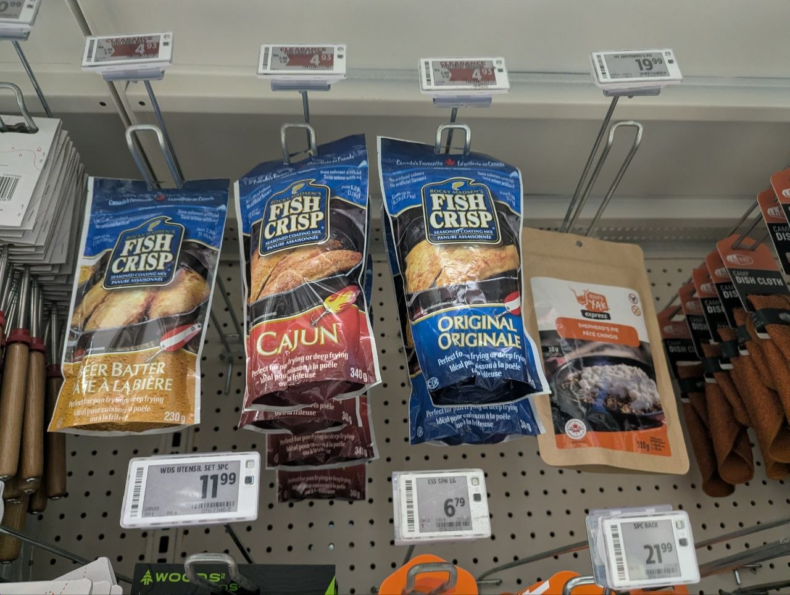
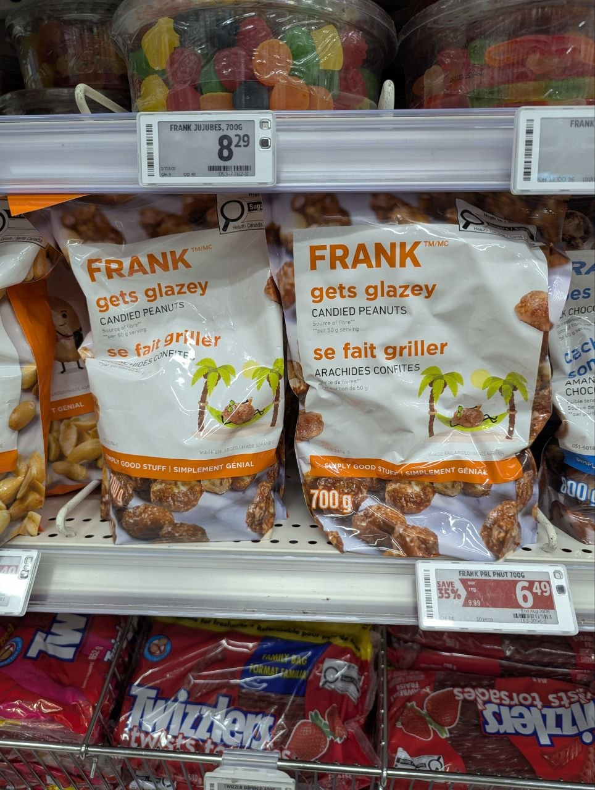
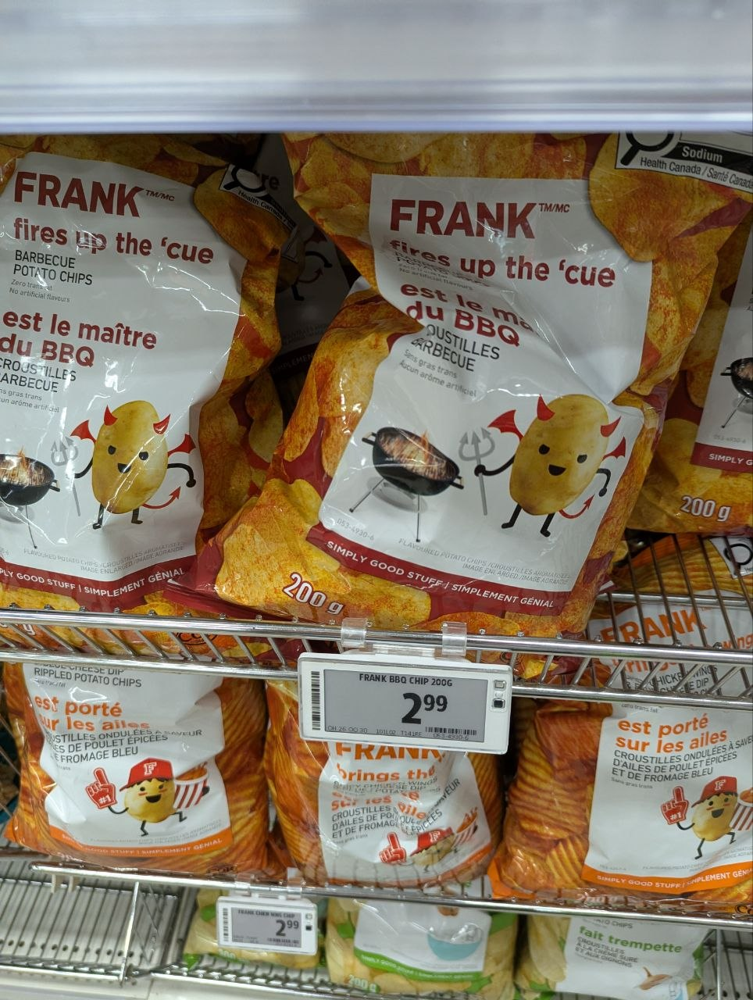
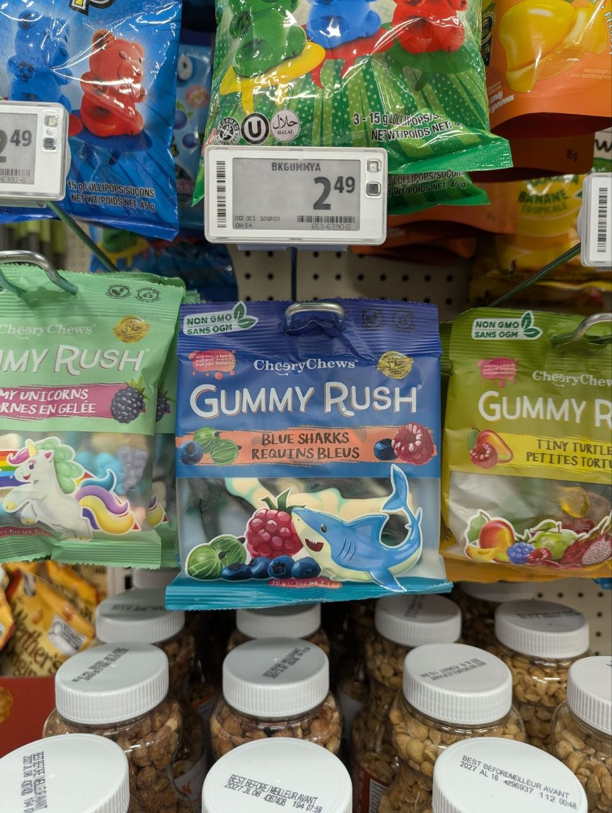
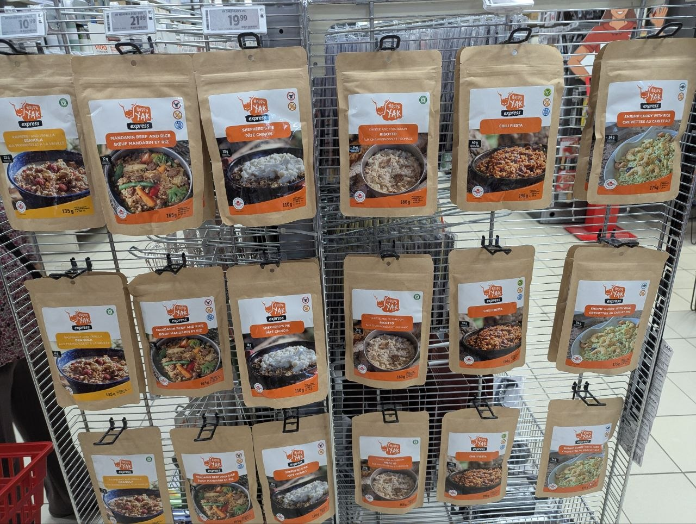
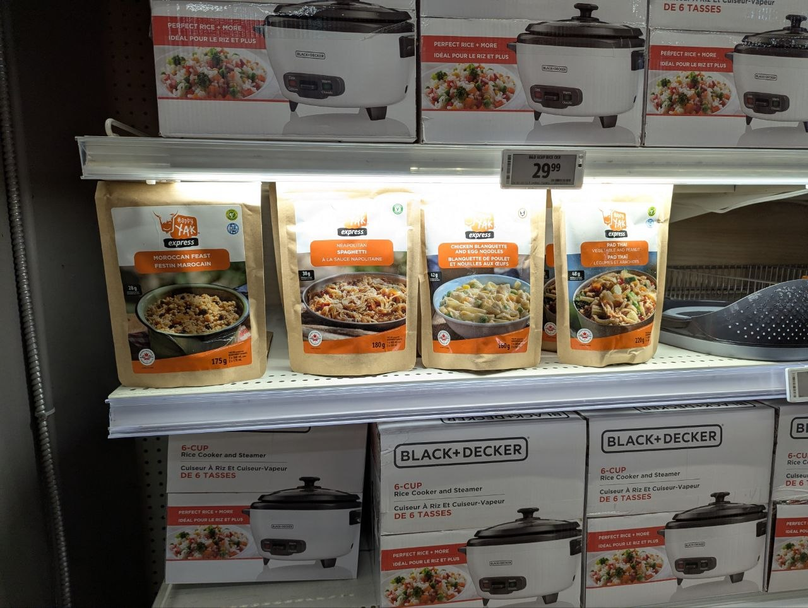
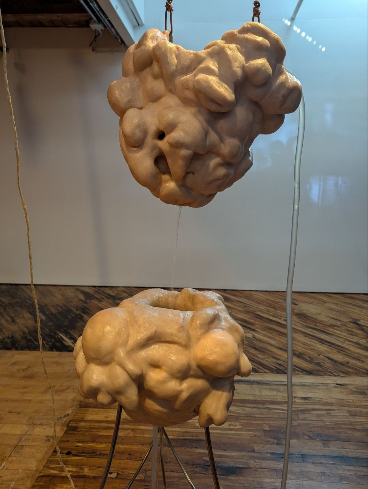
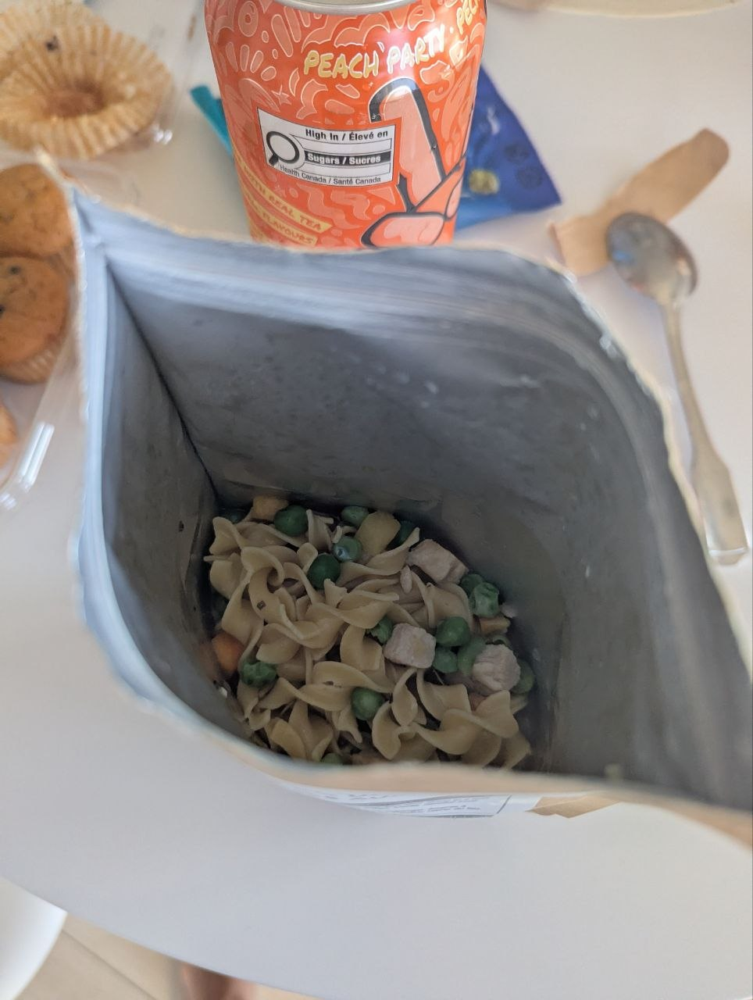
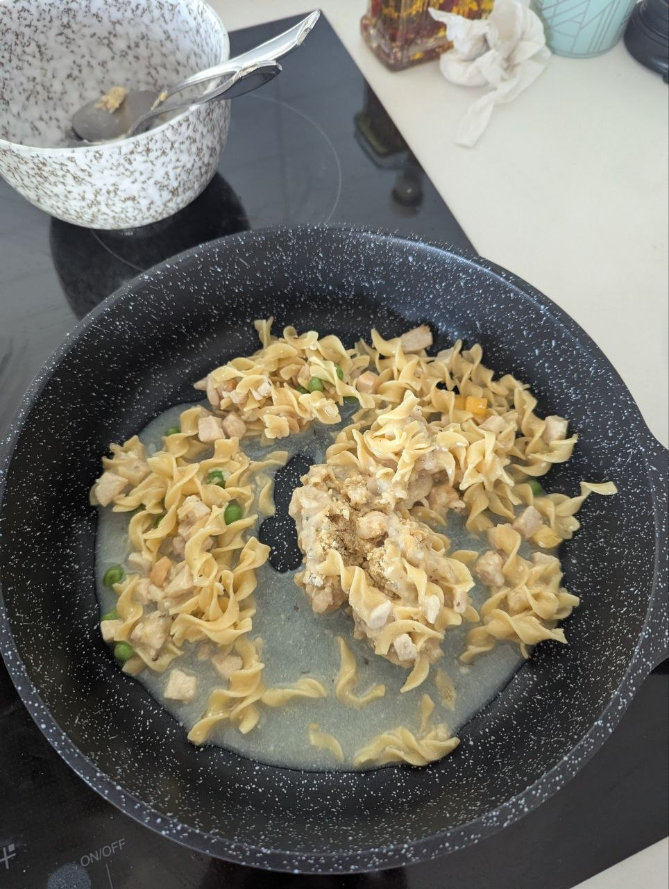
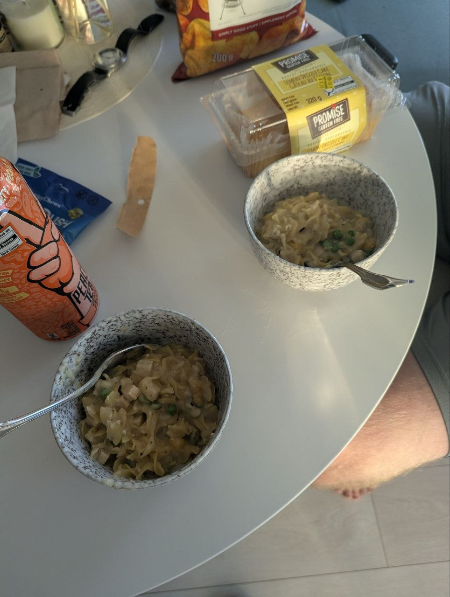

In July this year, for no particular reason, my father gave me a $50 Canadian Tire gift card. For weeks, this card sat at my desk, taunting me with its existence. What could I possibly need from Canadian Tire? It's a hardware store, and I live in a small rented apartment. I had all of the tools I needed. Any significant repairs would be taken care of by my landlord. I thought for a while.

Aha, an idea. I'd walk into a Canadian Tire and leave with a succulent three-course meal.

-\-

Was this even feasible? I worked with Claude to come up with a game plan. It browsed through the catalogue. You'd be surprised to learn at how much food is stocked at a supposed hardware store (would food be considered *soft*ware?). It turns out a lot of people go shopping at Canadian Tire for camping stuff, and thus it contained a solid selection of camping-style foods and snacks.

I decided to finalize my goals for the trip. Beyond simply surviving on Canadian Tire food, I'd want to thrive on it. I wanted a meal that wouldn't disappoint a Michelin-guide critic. I'd have a main, a snack or side, and a drink. I'd finish with a nice dessert.

What remained was for me to actually execute on the idea. Would they even have the foods stocked? What would the selection be like? Would the food be any good? Would the cashier judge me for buying a pile of food from the hardware store? There was only one way to find out.

-\-

On a bored mid-August evening, I'd decided that this was the day. I took the subway down to the Eaton Centre Canadian Tire. If you weren't aware, I absolutely love looking at *stuff*, and Canadian Tire is the epitome of *stuff*. 

I wandered around this huge store, and asked for assistance in locating the camping section. It was on the lower level, about two aisles worth of goods. I saw plenty of things: pots, pans, frying oil, folding chairs, portable stoves, luggable loos. All very wonderful and interesting objects that would be good finds on any other Canadian Tire excursion. Yet there was one obvious thing missing: food I could eat. I was about to call it quits, right when I saw it. *Shepherd's pie*. The last camping meal stocked in the section. I nearly leaped from my metaphorical chair (I'd have to fork out $12.99 for a real one, after discounts. A bit tight for my budget). Greedily, I yanked it from the shelf, to prevent any other shoppers from taking it while I was hunting for other foods. Little Timmy could go hungry on his camping trip for all I cared. Fuck you, Timmy.

Next order of business: the snack. This was easy. Most stores will set up a collection of snacks near the checkout area in order to exploit anybody with low impulse control. This time, I was not the victim; I was the hunter. This store had quite the selection of snacks: several aisles' worth. What to choose? I wanted to make sure my haul fit in my $50 budget, so I looked for bang for my dad's bucks. I considered popcorn, but I settled on FRANK &trade; Gets Glazey Candied Peanuts (for me) and FRANK &trade; Fires Up The 'Cue Barbecue Rippled Potato Chips (for my partner, who has a peanut allergy) as snacks, and CheeryChews &reg; Gummy Rush Blue Sharks for dessert. For the uninformed plebs (you, most likely) who are not Canadian Tire aficionados, FRANK &trade; is their own in-house private-label store brand.

Before heading out to pick up the final item (a drink) from the cashier area, I wandered a bit more around the front of the store. That's when I saw *it*.

You know that [scene](https://www.youtube.com/watch?v=1hyEnE1SwQA) from *500 Days of Summer* where Summer says she likes the Smiths$^1$? It was like that. *Holy shit*. This must have been what it felt like for Yeltsin to have visited that grocery store in Texas. What it must have been like for King Solomon to have received gifts from the Queen of Sheba$^2$. Or Dorothy stepping out into Technicolour. Et cetera.

Hanging from the rack in front of me was the most extensive collection of camping food I had ever seen in my miserable twenty-five years of existence. Chinese. Mexican. Indian. You name it, they've got it. This is probably what they mean when they sing about a feast waiting for you in heaven at church.

I was mildly dizzy from the whiplash of going from no options to an overwhelming number of them. If I made the wrong choice, the blog post I'd write about this experience would have been lame, and thus my life would be essentially over. Good thing, then, that one option whispered into my ear, like a siren calling to Odysseus. It even had a heavenly glow from the harsh fluorescent lights mounted on the shelf above. Happy Yak &trade; Express Chicken Blanquette and Egg Noodles it was, then. I had little say in the matter. I swapped it for the shepherd's pie I had in my hand, which I did not care for any longer. Friendship ended with shepherd's pie. Now chicken blanquette is my best friend.

On the way out of the store, I picked up some Arizona iced teas to drink with the meal. The journey was long and winding but I had succeeded in my goal.

The final collection was heavy. Like, very heavy, way more than I expected. Between seven and ten pounds heavy, I'd wager, carried around in a shopping bag by hand. The peanuts were kind of a bulk item, and the two large Arizona iced teas weren't helping. This was problematic since I had planned to visit the wonderful 401 Richmond art hub$^3$, which was already a somewhat lengthy stroll under normal conditions, and these were not normal conditions. Ignoring this obstacle, I decided that I had a plan, and that I would stick to it. I probably walked for four hours that day, awkwardly hoisting my haul the entire time. I saw strange and wonderful objects with my feast by my side.

-\-

August 27, Judgement Day. I'd invited my friend Philip$^4$ to witness the birth of my edible creation and participate in its devouring[.](https://en.wikipedia.org/wiki/Saturn_Devouring_His_Son)

Everything was pretty much ready-to-eat, except the blanquette, which needed cooking. It was camping food. There was like, a single instruction written on the back of the packaging. How hard could it be to prepare?

Wrong. Very fucking wrong.

I carefully read the instructions and followed them to the letter.

> Add boiling water, stir thoroughly. Seal pouch.
>
> Let stand for 18-20 min, stirring once or twice.

I did just that. After pouring in the boiling water from my kettle I waited ten minutes before stirring. Then, I let it sit for another ten before opening up the package.

There was a bunch of water left in the bag. At this point I'm thinking that the image on the package was misleading and this was in fact supposed to be a noodle soup rather than a dry noodle. Whatever, as long as it was edible, I didn't care. I poured it into a bowl, slowly. All the water and noodles come out of the package. Then, slowly, almost with comedic timing, a giant hardened ball of seasoning came tumbling out of the package and into the bowl.

You see, my folly was in assuming that the solid matter I had scraped the spoon against when mixing the noodles during halftime was the bottom of the bag. It was not, in fact, the bottom of the bag. It was, in fact, an extremely hard lump of seasoning formed due to the presence of liquid but not enough stirring. The closest thing I could find to describe this phenomenon was "[agglomerated food powder](https://en.wikipedia.org/wiki/Agglomerated_food_powder)" on Wikipedia, but I still don't think this is precisely the same thing as what happened to me. It's likely that we created new science when making this meal.

At this point, I gave up. I wanted to make the meal in the bag, camping style, since it would not require tools outside of what was purchased during the Canadian Tire run. But I was desperate and this was clearly not going as I'd hoped, so I swallowed my pride and dumped everything into a pan that I heated on the oven. Honestly it looked like a pile of wet diarrhea from an incontinent 80-year-old that needs to eat more fibre. I broke apart the seasoning lumps with a spatula and the mixture started resembling something that looked like actual food.

We ate the noodles. Final verdict? I mean, it was *fine*. It's camping food. What the hell did you expect?

The same can largely be said about the rest of the meal. It was all just okay. I ended up pawning off most of the peanuts to my friend Leo.

-\-

Now, dear reader, you ask me, what was the point of all this? Well, AI is going to kill us all in a few short years, and if that doesn't work, global warming will, and if we are lucky enough to survive that, then the universe will have a heat death eventually anyways. So there was no point. The food was very mid. But if you really wanted to take away a lesson from all this I'd say something about how the journey was more important than the destination. Or perhaps that it was cool that I had an idea in my mind for something no sane person would have ever done, and actualized it into reality. But I won't go there.

-\-

$^1$ one of my favourite movies.

$^2$ as depicted in the food-fight-damaged and vandalized 17th-century Belgian tapestry that can be found hanging in Strachan Hall in the University of Trinity College in the University of Toronto. Allegedly the Queen gave the King over four tons of gold.

$^3$ I'd definitely recommend a drop by 401 Richmond. You can easily spend a whole day there. There are wonderful Toronto-themed stores which are perfect for gifting.

$^4$ [pharker.substack.com](https://pharker.substack.com/)